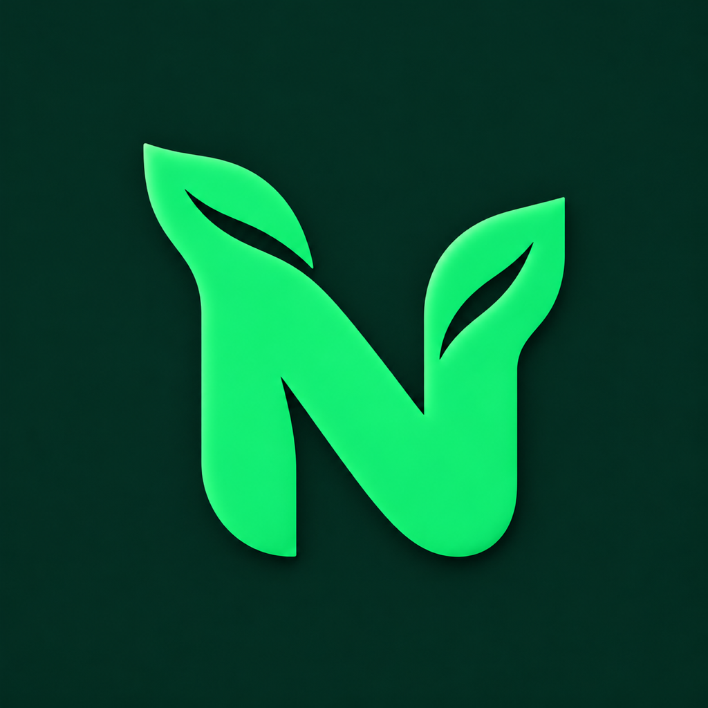

<div align="center">
  

  <h1>NutriMind</h1>
  <p><strong>Eat mindfully. Watch your habits grow.</strong></p>
  <p>A nutrition diary with meal recognition from photos,<br />personal goals, and a little garden that grows with you.</p>

  <p>
    <a href="#features">Features</a> ·
    <a href="#small-steps-a-growing-garden">My garden</a> ·
    <a href="#local-setup">Getting started</a> ·
    <a href="#documentation">Documentation</a>
  </p>

  <p><sub>Flutter · Next.js · FastAPI · PostgreSQL</sub></p>
</div>

---

## Features

**From photo to diary in just a few steps.** Take a picture of your meal, review the recognized ingredients and portions, and save the result. Add your favorite meals again without scanning them each time.

| Every day | What you get |
| :--- | :--- |
| **Nutrition at a glance** | Calories, protein, fat, and carbs against your personal targets. A compact remaining-calorie indicator and daily balance. |
| **Beyond calories** | Water tracking, weight history, day navigation, and personal nutrition settings. |
| **A helping hand** | An AI chat assistant with context about your nutrition and goals. |
| **Motivation without pressure** | A diary streak and a personal garden with five growth stages. Missing a day does not destroy your plant. |
| **Thoughtful details** | Undo deletion, recover unfinished saves after network failures, and prevent duplicates when retrying requests. |
| **At your own pace** | Day changes follow your device's time zone. The mobile interface supports English, Russian, and Georgian. |

## Small steps, a growing garden

<div align="center">
  
  
  
  
  
  <p><sub>Five growth stages · One tree for every 21 days with food entries</sub></p>
</div>

One day with a food entry earns one step of growth. Days do not need to be consecutive, and neither logging more meals nor hitting your calorie target makes the plant grow faster. You do not need to eat avocados, either.

Your garden shows the current stage, days of growth, and progress toward the next stage. Preview future stages at any time; fully grown trees stay in your collection.

## Project structure

| Component | Technologies | Source |
| :--- | :--- | :--- |
| Mobile app | Flutter / Dart · iOS and Android | [`flutter_app/`](flutter_app/) |
| Web app | Next.js 16 · React · TypeScript | [`nutrimind/`](nutrimind/) |
| Shared API | FastAPI · SQLAlchemy · Alembic · Gemini | [`backend/`](backend/) |
| Local infrastructure | PostgreSQL · Redis · MailHog · Docker Compose | [`docker-compose.yml`](docker-compose.yml) |

The mobile and web clients share the same API. The Telegram bot and Elastic observability stack are optional Compose profiles. The project is under active development; automated production deployment is not yet configured.

## Local setup

You will need Docker Compose and Make; on macOS, you can use OrbStack. Run these commands from the root of the cloned repository.

**1. Configure your environment.** Copy the template on your first run; keep any existing `.env` file.

```sh
cp .env.example .env
```

Set your own `JWT_SECRET` and Gemini keys (`GEMINI_API_KEY`, `GOOGLE_GEMINI_API_KEY`) in `.env` to enable AI features. Keep local secrets out of Git.

**2. Start the development environment.**

```sh
make dev
```

The backend reloads when its code changes, and the web app supports Fast Refresh. The first run builds the images and installs dependencies.

| Service | Default address |
| :--- | :--- |
| Web app | [localhost:3000](http://localhost:3000) |
| Interactive API documentation | [localhost:8000/api/docs](http://localhost:8000/api/docs) |
| API health check | [localhost:8000/health](http://localhost:8000/health) |
| MailHog local inbox | [localhost:8025](http://localhost:8025) |

Use `make dev-logs` to view logs and `make help` to list available commands. Database schema changes must be applied separately through Alembic; server reloads do not replace migrations.

**3. Run the mobile app.** Install Flutter and the tools for your target platform: Xcode for iOS or the Android SDK for Android.

```sh
cd flutter_app
flutter pub get
flutter devices
flutter run -d <DEVICE_ID> --dart-define=API_BASE_URL=<BACKEND_URL>
```

Replace `<DEVICE_ID>` with an identifier from the device list and `<BACKEND_URL>` with your API address: `http://localhost:8000` for iOS Simulator, `http://10.0.2.2:8000` for the standard Android Emulator, or your computer's LAN address for a physical phone. The phone and computer must share an accessible local network. Installing on an iPhone requires signing setup in Xcode — see the [guide](docs/MOBILE_PERFORMANCE.md).

## Documentation

- [Local development and hot reload](docs/DEVELOPMENT.md) · [OrbStack and containers](ORBSTACK.md)
- [Saved meals](docs/SAVED_MEALS.md) · [Undo deletion and recovery](docs/DIARY_RECOVERY.md)
- [Duplicate-save prevention](docs/IDEMPOTENT_SAVES.md) · [Dates and time zones](docs/DIARY_TIME.md)
- [Personal garden](docs/GARDEN.md) · [Daily goals](docs/DAILY_GOALS.md)
- [Performance testing on a phone](docs/MOBILE_PERFORMANCE.md) · [App icon and branding](docs/BRANDING.md)

---

<div align="center">
  <p><strong>Small steps, every day.</strong><br /><sub>NutriMind · <a href="LICENSE">MIT License</a></sub></p>
</div>
